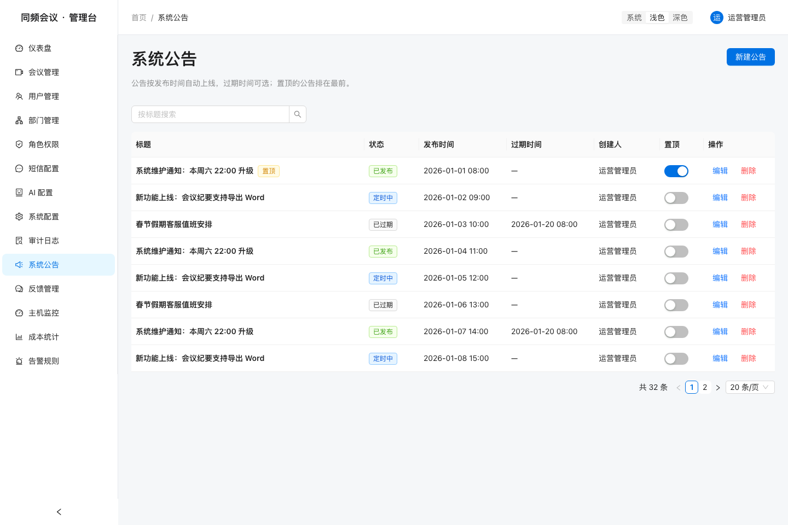
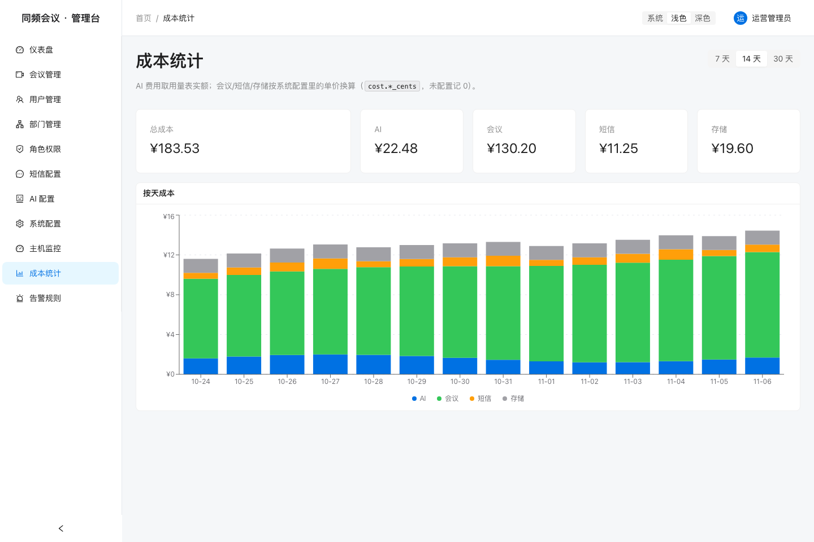

# 同频会议

面向团队日常沟通的视频会议平台：Web 端开会、桌面端常驻、管理台做运营。一个 pnpm monorepo，含服务端、三个前端与共享契约。



## 技术栈

| 层 | 选型 |
|---|---|
| 服务端 | NestJS 11 + Prisma 6 + PostgreSQL 16；WebSocket 网关、RBAC、审计日志 |
| Web 端 | Vue 3 + Vite + Pinia；开麦/共享/白板等会中能力 |
| 桌面端 | Electron 39 + electron-vite；窗口池、自定义共享选择器、自动更新、托盘、`tongpin://` 深链 |
| 管理台 | React 19 + Ant Design 5 + Recharts；统计、用户/部门/角色、配置、审计、告警、导出 |
| 共享层 | `@tongpin/shared`（zod 契约、枚举、状态机、错误码、权限点）、`@tongpin/tokens`（设计变量） |

## 目录结构

```
apps/
  web/        会议 Web 端（Vite，5173）
  admin/      运营管理台（Vite，5174）
  desktop/    桌面端（Electron 主进程 / preload / renderer）
server/       NestJS API（3000）、网关（3001）、AI 服务（3002）
packages/     shared / tokens / theme / platform / config / app-core
assets/       README 截图
```

## 本地启动（5 分钟）

依赖：Node 22（见 `.nvmrc`）、pnpm 11、Docker（只为 PostgreSQL）。

```bash
pnpm install

# 只起 PostgreSQL；.env 默认连 localhost:5432/tongpin
docker compose up -d

cp server/.env.example server/.env
pnpm db:migrate     # 建表
pnpm db:seed        # 写入演示账号与基础数据

pnpm dev            # 并行起 server + web + admin + desktop
```

分开起：

```bash
pnpm dev:web        # http://localhost:5173
pnpm dev:admin      # http://localhost:5174
pnpm dev:desktop    # Electron 开发窗口
```

演示账号（`pnpm db:seed` 写入）：

| 账号 | 手机号 | 密码 | 角色 |
|---|---|---|---|
| 管理员 | `13800000000` | `admin123` | 超级管理员 |
| 普通用户 | `13800000001` | `user123` | 普通成员 |



## 常用脚本

| 命令 | 作用 |
|---|---|
| `pnpm dev` | 全部应用并行开发模式 |
| `pnpm build` | 按依赖顺序构建全部包 |
| `pnpm typecheck` / `pnpm lint` / `pnpm test` | 全仓检查与单测 |
| `pnpm db:migrate` / `pnpm db:deploy` | 本地迁移 / 生产执行迁移 |
| `pnpm db:seed` | 演示数据（可重复执行） |
| `pnpm db:studio` | Prisma Studio |
| `pnpm --filter @tongpin/desktop dist` | 桌面端安装包（mac dmg+zip、win nsis、linux AppImage） |

## 自托管基础设施

`docker-compose.yml` 里 PostgreSQL 默认启动，其余三个服务在 `full` profile 中，按需开启：

```bash
docker compose up -d                     # 仅 PostgreSQL
docker compose --profile full up -d      # + Redis + MinIO + LiveKit
```

服务端用 `*_PROVIDER` 环境变量决定实现，不配就降级到内存 / 本地磁盘 / mock RTC，因此本地开发只需要 PostgreSQL：

| 变量 | 默认 | 说明 |
|---|---|---|
| `CACHE_PROVIDER` | `memory` | `redis` 时读 `REDIS_URL` |
| `SMS_PROVIDER` | `mock` | `aliyun` 时填 AK/SK 与签名 |
| `STORAGE_PROVIDER` | `local` | `s3` 时读 `S3_*`，MinIO 控制台 `:9001` |
| `RTC_PROVIDER` | `mock` | `livekit` 时读 `LIVEKIT_*`，本机 `ws://localhost:7880` |
| `AI_PROVIDER` | `mock` | `openai` 时读 `OPENAI_*` |

导出文件默认写入 `server/storage/exports`，可用 `TONGPIN_EXPORT_DIR` 改目录；短信与 AI 的密钥用 `TONGPIN_CONFIG_KEY` 派生 AES-256-GCM 密钥加密后入库。

桌面端更新只在打包后启用，发布源通过 `TONGPIN_UPDATE_URL` 注入（`electron-updater` 的 generic provider）。

## 架构简述

```
Web / Desktop / Admin
        │  HTTPS + WebSocket
        ▼
   API(3000) ── Gateway(3001) ── AI(3002)
        │            │              │
        └──── PostgreSQL ───────────┘
              Redis / MinIO / LiveKit（可选）
```

- 三端共用 `@tongpin/shared` 的 zod 契约与枚举，前后端各自校验同一份形状。
- 桌面端通过 `@tongpin/platform` 的六个 Port 隔离 Electron 与浏览器差异，业务代码不直接读 `window.api`。
- 管理台所有写操作同时受服务端 RBAC 与前端 `<Can perm>` 限制，无权限时按钮不渲染、路由直接 403。

## 状态

里程碑 M0–M11 已完成：账号与会议主链路、Web 端会中能力、桌面端（共享选择器/更新/托盘/深链/三端打包）、管理台（统计、用户、部门、角色、配置、审计、告警、导出、按钮级权限）。M12 收尾中：README 与 compose 已就绪，安装包发布、Playwright 冒烟与 CONTRIBUTING/LICENSE 待补。

## License

MIT（LICENSE 文件随 M12-3 补入）。
